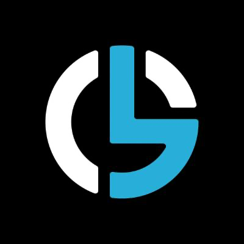

<h1 align="center">
   
  GanbitLabs
</h1>

  We build on Sui and Walrus: <a href="https://ganbitera.io"><b>Ganbitera</b></a> and <a href="https://walgo.xyz"><b>Walgo</b></a>.

---

## Ganbitera

An NFT marketplace and launchpad on Sui. Creators launch collections; collectors trade them.

- **Launchpad**: drops with mint stages and allowlists, editions, generative collections, and delayed reveal.
- **Marketplace**: listings, offers, collection offers and auctions, settled in Sui kiosks with creator royalties enforced on chain.

[ganbitera.io](https://ganbitera.io) · [X](https://x.com/ganbitera) · [Telegram](https://t.me/+41iPFEL9XpkzNzJk)

## Walgo

Deploy static sites to Walrus decentralized storage, with no blockchain experience required. Walgo won a Walrus RFP.

- [**walgo**](https://github.com/ganbitlabs/walgo): the CLI. `walgo launch` takes a Hugo site to Walrus, with SuiNS names for custom domains.
- [**Walgo Web**](https://web.walgo.xyz): deploy from the browser with just a Sui wallet.
- [**walgo-mcp**](https://github.com/ganbitlabs/walgo-mcp): lets AI coding agents drive Walgo; every transaction is signed in your browser.
- Hugo themes for Walrus sites: [walgo-whitepaper](https://github.com/ganbitlabs/walgo-whitepaper), [walgo-biolink](https://github.com/ganbitlabs/walgo-biolink).

[walgo.xyz](https://walgo.xyz)

## Contact

**info@ganbitera.io**: general questions, partnerships and security reports. Please report vulnerabilities privately rather than in a public issue.
